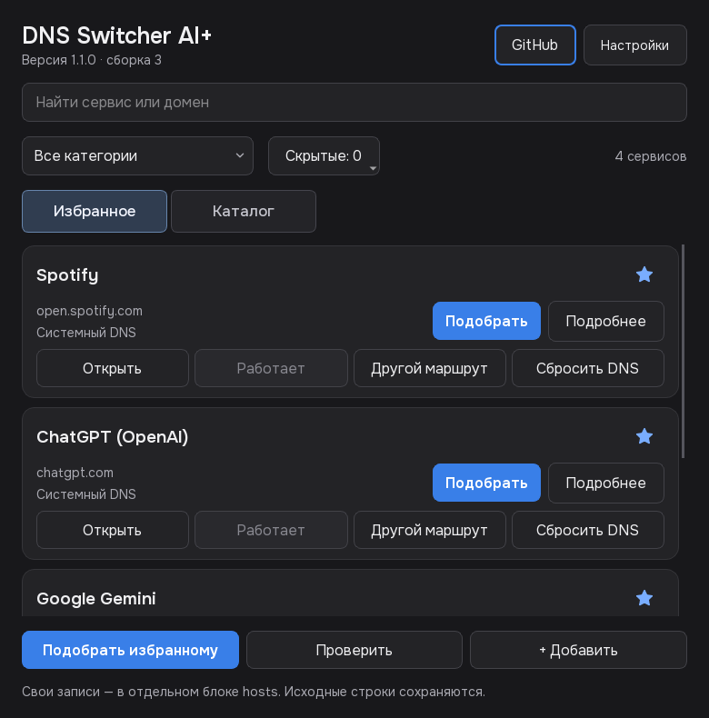

# DNS Switcher AI+ 1.1

Windows-приложение для подбора DNS/SNI-маршрутов к AI и повседневным сервисам. Тёмный интерфейс, избранное, связанные домены и системный трей.



Сборка 3: номер виден в окне. Исправлена запись в hosts, когда Windows разрешает запись, но запрещает переименование открытого файла. Добавлен общий Windows mutex для всех версий и путей EXE; повторный запуск открывает существующее окно. Исправлено исключение общего IP сайта и API при смене маршрута; итог применения или отсутствие альтернативы показаны под списком.

## Скачать

Portable EXE: [Releases](https://github.com/pryanus/dns-switcher-ai-plus/releases/latest). Установка не требуется; Windows запросит права администратора.

Избранное: Spotify, ChatGPT, Gemini и Claude. Крестик скрывает окно в трей. Полный выход — через меню значка приложения.

## Использование

1. При запуске приложение проверяет активные записи избранного в hosts без изменения файла. Если текущий адрес отвечает по HTTPS, показывает **Работает** и сохраняет его, независимо от провайдера. **Подобрать** также сначала проверяет текущий маршрут.
2. **Работает** означает доступность текущего сетевого маршрута. Сессию аккаунта и нужные функции можно подтвердить одноимённой кнопкой; отказ автоматического запроса не выдаётся за недоступность сервиса.
3. Большая кнопка **Другой маршрут** явно запускает смену адреса и перебирает пул по кругу. Сначала проверяется пригодность, затем среди подходящих вариантов учитывается отклик. Рабочий активный DNS ради меньшего отклика самопроизвольно не меняется. После полного круга ранее пропущенные IP снова доступны, кроме активного адреса. Если альтернативы нет, текущий маршрут сохраняется и это явно сообщается. **Начать пул сначала** в деталях сбрасывает выбор и начинает подбор с GeoHide по приоритету провайдеров. DNS-AI можно отключить в настройках провайдеров.

В настройках на вкладке **Обновление** можно проверить GitHub и скачать/установить новую стабильную версию. Файл проверяется по SHA-256; EXE заменяется после завершения приложения, предыдущая версия сохраняется рядом. Системный hosts и настройки обновлением не перезаписываются.

Избранное и каталог не пересекаются. В каталоге кнопка **Подобрать всем** обрабатывает только каталог, не затрагивая избранное; **Проверить** следует тому же правилу. В избранном — **Подобрать избранному**. Синяя **Подобрать** на карточке действует только на один сервис; **Подробнее** открывает диагностику. Claude включён в стандартное избранное. Из стандартного списка убраны сервисы с неподтверждённым обходом, включая Grok и Groq. Техническая доступность маршрута не доказывает работоспособность аккаунта.

**Сбросить DNS** виден прямо на карточке сервиса без раскрытия деталей. **Сбросить DNS всех сервисов** виден внизу настроек на любой вкладке. Сброс удаляет исключительно блоки DNS Switcher и возвращает исходные записи; перед изменением создаётся бэкап. Чужие строки, DNS адаптера и исходный hosts не заменяются.

Есть звёздочки избранного, скрытие/возврат сервисов, параллельные проверки с отменой, обновление баз, настраиваемый фоновый мониторинг и защита от повторного запуска.

Провайдеры: GeoHide RU/EU/US, MALW DNS, Zapret DNS, DNS-AI и пользовательские. **Проверить** не записывает hosts. **Подобрать** добавляет проверенные адреса в отдельные блоки, сохраняет исходные строки и создаёт резервную копию. DNS адаптера не меняется. Блоки сервисов разделены пустыми строками, IP и домены выровнены пробелами. Настройки и резервные копии остаются локальными.

## Ограничения

DNS/SNI не заменяет VPN или обход DPI, не меняет регион аккаунта, не предоставляет подписку и не доказывает работоспособность всех функций по открывшейся главной странице. Старые результаты не показываются как текущая доступность. После новой проверки появляется краткий нейтральный результат; техническая диагностика доступна только в «Деталях», без всплывающего отчёта.

Netflix, Prime Video, HBO Max, Hulu и TIDAL исключены из стандартного каталога: обход текущим пулом не подтверждён.

Hosts не поддерживает wildcard; новые динамические адреса файлов требуют обновления базы. Сторонние записи с другими IP могут конфликтовать: строка выше не гарантирует приоритет. Во время записи завершите запрос UAC; отмена сохраняет уже завершённые применения.

## Исходники и сборка

Windows, Python 3.12+:

```powershell
python -m venv .venv
.\.venv\Scripts\python.exe -m pip install -r requirements.txt
.\.venv\Scripts\python.exe src\main.py
.\.venv\Scripts\python.exe -m unittest discover -s tests
.\.venv\Scripts\python.exe build_exe.py
```

Сборка создаёт `dist/DNS_Switcher.exe` с запросом прав администратора. Тесты используют временные hosts и подменённую сеть.

## Компоненты и источники

[GeoHide](https://geohide.ru/), [MALW DNS](https://github.com/ImMALWARE/dns.malw.link), [Zapret DNS](https://dns.zapret.moe/), [DNS-AI](https://dns-ai.ru/). Поддержка сервисов у провайдеров может меняться.

PySide6, httpx с HTTP/2, dnspython, PyInstaller. Шрифт Onest — SIL Open Font License; лицензия находится в `src/assets/fonts/`.
